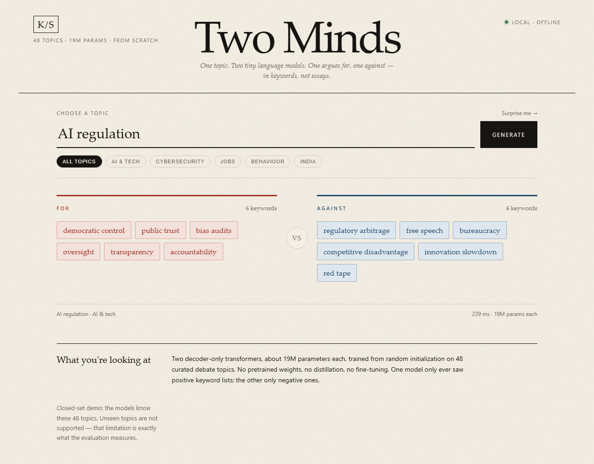

# TwinMinds — Stance Keyword SLMs

Two small language models trained **from scratch** — no pretrained weights, no distillation, no fine-tuning. One emits positive keywords for a topic; the other emits negative keywords. A local web app puts them side by side with a sub-millisecond retrieval fallback for open-domain topics.



## Overview

TwinMinds explores the capability boundary of small language models (SLMs, ~19M parameters) trained strictly from random initialization for stance-conditioned generation:
- **Architecture:** Minimal decoder-only transformer with RoPE, RMSNorm, Grouped-Query Attention (GQA), SwiGLU activations, and tied embeddings.
- **Polarity baked into weights:** One model only saw positive keywords during training; the other only negative ones. Stance is architectural and data-driven, not prompt-instructed.
- **Dual-Mode Open-Domain Engine (T0):** Exact matches to the 48 curated debate topics are generated directly by the 19M-parameter transformers. Unseen topics and paraphrases route through a blended TF-IDF retrieval fallback (character n-grams + word n-grams + aliases) with calibrated uncertainty warning thresholds.

---

## Quick Start

### 1. Setup Environment

```powershell
pip install -r requirements.txt
```

### 2. Run Web Application

```powershell
python -m uvicorn app:app --host 127.0.0.1 --port 8000
```

Open [http://127.0.0.1:8000](http://127.0.0.1:8000). The models load and warm up in ~15 s; requests then take ~250 ms.

### 3. Generate from CLI

```powershell
python -m src.generate --ckpt outputs/pro-big/ckpt.pt --topic "AI regulation" --stance positive
python -m src.generate --ckpt outputs/con-big/ckpt.pt --topic "AI regulation" --stance negative
```

---

## Model Architecture & Training

| Parameter | Positive Model | Negative Model |
|---|---|---|
| **Parameters** | 19,009,536 (~19M) | 19,025,280 (~19M) |
| **Architecture** | Decoder-only Transformer | Decoder-only Transformer |
| **Layers / Heads / Width** | 8 / 6 / 384 | 8 / 6 / 384 |
| **Positional Embeddings** | RoPE (Rotary Position Embeddings) | RoPE |
| **Normalization** | RMSNorm | RMSNorm |
| **MLP** | SwiGLU | SwiGLU |
| **Attention** | Grouped-Query Attention (GQA) | GQA |
| **Vocabulary** | Word-level tokenizer (~1.5k vocab) | Same |
| **Precision** | bfloat16 | bfloat16 |
| **Training Time** | ~90 s on RTX 5070 Ti Laptop | ~90 s on RTX 5070 Ti Laptop |

### Train From Scratch

```powershell
# Positive model
python -m src.train --data data/pro/all.jsonl --out outputs/pro-big `
  --n-layer 8 --n-head 6 --n-embd 384 --block-size 96 --batch-size 32 `
  --max-steps 2500 --lr 5e-4 --dropout 0.05

# Negative model
python -m src.train --data data/con/all.jsonl --out outputs/con-big `
  --n-layer 8 --n-head 6 --n-embd 384 --block-size 96 --batch-size 32 `
  --max-steps 2500 --lr 5e-4 --dropout 0.05
```

---

## Evaluation & Open-Domain Benchmark

Run the automated evaluation suite:
```powershell
python scripts/eval_open_domain.py
```

| Evaluation Suite | Metric | Result |
|---|---|---|
| **Exact Match** (10 topics) | Routing Accuracy | **100.0%** (<0.01 ms) |
| **Paraphrases / Synonyms** (12 queries) | Top-1 Retrieval Accuracy | **100.0%** (mean sim: 0.33) |
| **Paraphrases / Synonyms** | Top-3 Retrieval Accuracy | **100.0%** |
| **Out-of-Domain Inputs** (10 queries) | Correct Uncertainty Warning Rate | **100.0%** (confidence < 0.15) |
| **Retrieval Overhead** | Latency | **~3.9 ms** |

For the complete academic analysis, empirical limits of small language models, and the scaling roadmap to multi-billion tokens, see [REPORT-OPEN-DOMAIN.md](REPORT-OPEN-DOMAIN.md).

---

## Repository Structure

```
SLM/
├── README.md                # Project overview, setup, and results
├── REPORT-OPEN-DOMAIN.md    # Complete course report & evaluation writeup
├── requirements.txt         # Python dependencies
├── app.py                   # FastAPI server with generative & retrieval routing
├── .gitignore
├── web/                     # Web interface (HTML, CSS, JS, preview assets)
├── src/
│   ├── model/gpt.py         # Decoder-only transformer from scratch
│   ├── train.py             # Explicit training loop (no Trainer library)
│   ├── generate.py          # CLI sampling
│   ├── retrieval.py         # T0 TF-IDF open-domain retrieval index
│   └── data/
│       ├── text.py          # Tokenizer & vocab
│       ├── keywords.py      # Statistical RAKE keyword extractor
│       ├── train_bpe.py     # T1 ByteLevel BPE tokenizer trainer
│       └── build_*.py       # Dataset generation pipelines
├── data/
│   ├── curated/topics.jsonl # 48 curated debate topics with pro/con keywords
│   ├── topics.jsonl
│   └── meta.json
└── scripts/
    ├── bench.py             # GPU training throughput benchmark
    ├── test_retrieval.py    # Retrieval smoke test
    └── eval_open_domain.py  # Quantitative evaluation suite
```
